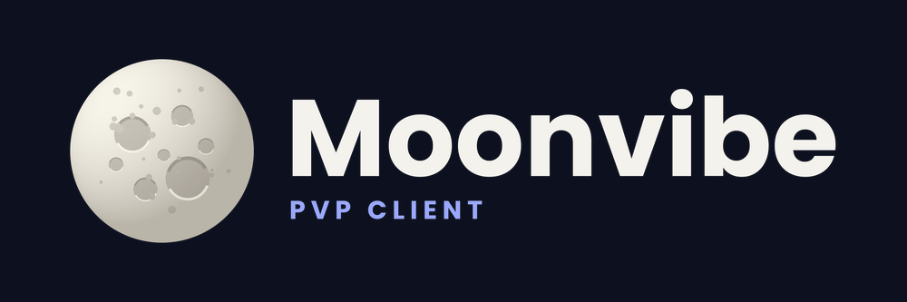
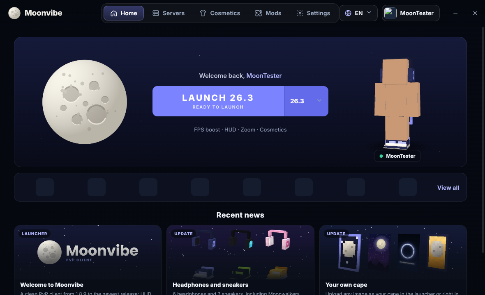
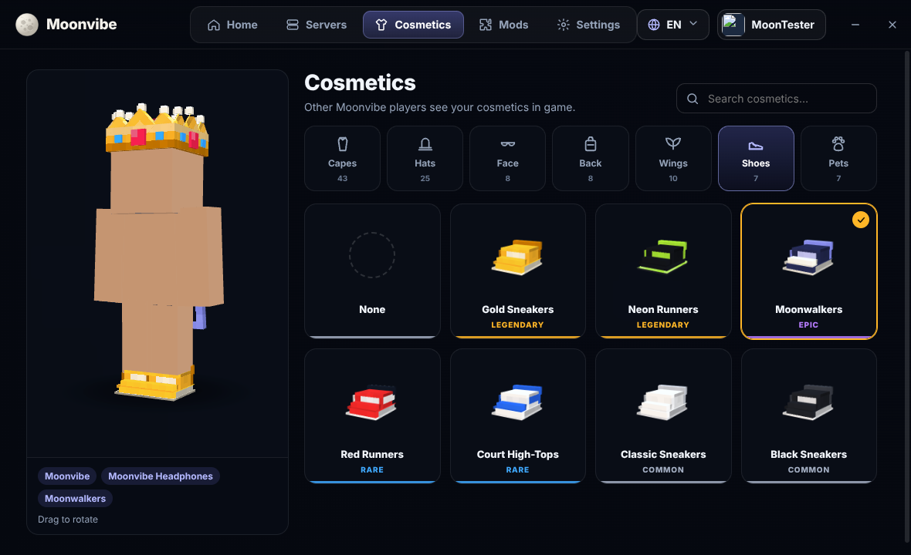
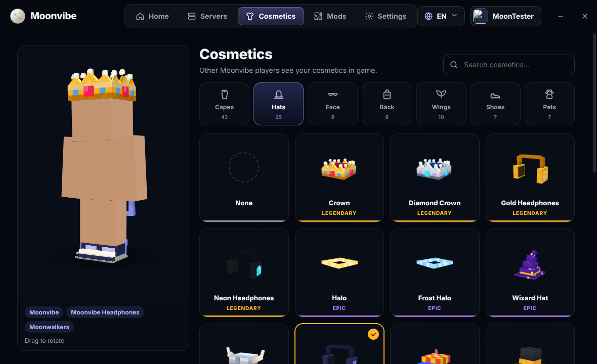

<p align="center">
  
</p>

<p align="center">
  <b>A Minecraft launcher and PvP client for 17 versions, from classic 1.8.9 PvP to 26.3.</b><br/>
  Similar to Lunar Client or Badlion: built-in HUD mods, zoom, cosmetics, your own cape and a launcher that sets up everything for you.
</p>

<p align="center">
  
</p>

---

## How to use Moonvibe

**Everything is in one package.** The installer contains the launcher, the client mod for all 17 Minecraft versions
(`launcher/client-mods/`), all 108 cosmetics and a built-in cosmetics server. A player installs it, types a
**username**, optionally uploads a **skin**, and plays. No login, no server and no setup are needed.

| What you want | What to do | Time |
|---|---|---|
| **Try it from source** | [Quick start](#quick-start-test-on-your-pc) | ~5 min |
| **An installer for your players** | [Tutorial 3](#tutorial-3-build-the-installer) (`build-installer.bat` or GitHub Actions) | ~10 min |
| **Cosmetics that other players can see** | [Tutorial 2](#tutorial-2-run-your-own-cosmetics-server-cloudflare-free) (shared cosmetics server) | ~20 min |
| **Sign-in with real Minecraft accounts** (optional) | [Tutorial 1](#tutorial-1-set-up-microsoft-login) (Microsoft app) | ~1 h plus waiting for Mojang |

### Accounts, skins and cosmetics

- **Username accounts:** the account window asks for a player name (3–16 characters: letters, numbers, `_`). That is
  all a player needs. Username accounts work in singleplayer and on servers that allow them (`online-mode=false`);
  servers that check for a paid Minecraft account need a Microsoft account (Tutorial 1).
- **Skins:** in the account window, **Upload skin** takes a 64×64 PNG (the old 64×32 format works too) and offers
  Classic and Slim arms. The skin is shown in the launcher and in game. In game it works through a small resource pack
  that the launcher writes into the game folder (`resourcepacks/moonvibe-skin.zip`), so it needs no mod update. The
  limit of this approach: only you see your skin, and other players without a skin of their own look like you on your
  screen.
- **Cosmetics:** without a shared server, the launcher uses its **built-in cosmetics server** (it runs inside the
  launcher on `127.0.0.1` and saves to the Moonvibe folder). Everything works in the launcher and in game, but only on
  that PC. With a shared server (Tutorial 2), all players who use it see each other's cosmetics; username accounts can
  use it too (the first launcher that uses a name reserves it on that server).

**Requirements:** Windows 10 or 11 · [Node.js](https://nodejs.org) 22 or newer (LTS) · internet access.
Java and Minecraft are downloaded automatically.

---

## Contents

- [Features](#features)
- [Screenshots](#screenshots)
- [Supported versions](#supported-versions)
- [Quick start (test on your PC)](#quick-start-test-on-your-pc)
- [Tutorial 1: Set up Microsoft login](#tutorial-1-set-up-microsoft-login)
- [Tutorial 2: Run your own cosmetics server (Cloudflare, free)](#tutorial-2-run-your-own-cosmetics-server-cloudflare-free)
- [Tutorial 3: Build the installer](#tutorial-3-build-the-installer)
- [Cosmetics](#cosmetics)
- [Languages](#languages)
- [Branding](#branding)
- [For developers](#for-developers)
- [Fair play and legal](#fair-play-and-legal)
- [License](#license)

---

## Features

| Part | Folder | What it does |
|---|---|---|
| **Launcher** | `launcher/` | Installs Minecraft, Java and Fabric automatically · server list with live player counts and one-click join · mods, resource packs and shaders from Modrinth (categories, sorting, Iris check) · 108 cosmetics (capes, hats, headphones, glasses, backpacks, wings, sneakers, pets) with a 3D preview · upload your own cape (with editor) · news · username accounts with skin upload (no login) · optional Microsoft login · built-in cosmetics server · works offline after the first start · 6 languages |
| **Client mod** | `mod/` (1.14.4 – 26.3) and `mod-legacy/` (1.8.9 – 1.13.2) | Custom main menu and loading screen · Moonvibe menu (**Right Shift**) with HUD editor, mod cards and cosmetics wardrobe · 20 modules · zoom (**C**) · Discord status |
| **Cosmetics server** | `backend/` | Stores who wears what, accepts custom capes and serves 3D models, textures, thumbnails and news. You run your own, for free on Cloudflare. |
| **Branding** | `branding/` | Original logos plus a script that renders every size |

**Modules:** FPS · CPS · Ping · Coordinates · Clock · Server address · Memory · Keystrokes · Armor status · Potion effects ·
Toggle sprint · Combo counter · Reach display · Speed · Compass · Item counter · Crosshair · Zoom · Discord status · Cosmetics.
Every HUD module can be dragged anywhere (it snaps to edges). Right-click a module to change its settings.

---

## Screenshots

<table>
  <tr>
    <td></td>
    <td></td>
  </tr>
  <tr>
    <td align="center">Sneakers in the new Shoes slot</td>
    <td align="center">Hats and headphones with a 3D preview</td>
  </tr>
</table>

---

## Supported versions

The launcher only lists versions where **everything** works (HUD, menus, zoom, cosmetics, custom cape):

| Version | Built from | Note |
|---|---|---|
| **26.3**, **26.2**, **26.1.2** | `mod/` (Fabric) | current releases |
| **1.21.11**, **1.20.6**, **1.19.4**, **1.18.2**, **1.17.1** | `mod/` (Fabric) | |
| **1.16.5**, **1.15.2**, **1.14.4** | `mod/` (Fabric) | the launcher starts these with Java 17 instead of Java 8 (the mod needs it, works fine) |
| **1.13.2**, **1.12.2**, **1.11.2**, **1.10.2**, **1.9.4**, **1.8.9** | `mod-legacy/` (Legacy Fabric) | separate code for the old engine, but it looks the same |

---

## Quick start (test on your PC)

Download this repository (**Code → Download ZIP**, then unpack it) or clone it. You need [Node.js](https://nodejs.org) (LTS).

1. Double-click **`start-launcher.bat`**. The first start installs the launcher's dependencies. The client mod is
   already included, so nothing has to be built.
2. Type a **username** in the account window (it opens by itself on the first start) and, if you like, upload a skin.
3. Pick a version and press **LAUNCH**.

In game:
- **Right Shift** opens the Moonvibe menu: drag modules with the mouse, right-click a module for its settings,
  "Mods" shows all modules as cards and "Cosmetics" opens the wardrobe (try on, wear, upload your own cape).
- Hold **C** to zoom. The mouse wheel changes the zoom level.
- Change keys under Options → Controls → category "moonvibe".

> The **Sign in with Microsoft** button only appears once a client ID is set up
> ([Tutorial 1](#tutorial-1-set-up-microsoft-login)). Username accounts always work.

---

## Tutorial 1: Set up Microsoft login

This tutorial is **optional**: username accounts work without it. Do it if your players should also be able to sign in
with a real Minecraft account (needed for servers that check accounts).

Every launcher (Lunar, Badlion, Prism …) has its own app registered with Microsoft. Without one, nobody can sign in
with a real Minecraft account in the finished launcher. The code is ready; it only needs an **Application (client) ID**.

> **Privacy:** Whatever you enter at Microsoft (name, phone, card for verification) is only seen by Microsoft.
> Players only see the app name "moonvibe". Tip: use a separate Microsoft account just for the project.

### Step 1: Get a directory (only if Azure shows a warning)

Open <https://portal.azure.com/#view/Microsoft_AAD_RegisteredApps/ApplicationsListBlade>.
If you see the warning *"The ability to create applications outside of a directory has been deprecated"*,
your account has no directory yet. Click **"sign up for Azure"** in the warning (or go to <https://azure.microsoft.com/free>)
and create the free Azure account. It asks for a phone number and a card to confirm you are a real person.
Registering an app costs nothing. Afterwards, open the link above again; the warning is gone.

### Step 2: Register the app

1. On the **App registrations** page, click **+ New registration**.
2. Fill in:
   - **Name:** `moonvibe`. The name must not contain Minecraft, Mojang, Microsoft or Xbox.
   - **Supported account types:** **Personal Microsoft accounts only**.
   - **Redirect URI:** platform **Public client/native (mobile & desktop)**, value
     `https://login.microsoftonline.com/common/oauth2/nativeclient`
3. Click **Register**.
4. In the left menu, open **Authentication**, set **Allow public client flows** to **Yes** and click **Save**.
5. Open **Overview** and copy two values:
   - **Application (client) ID**: goes into the launcher.
   - **Directory (tenant) ID**: only needed for the Mojang form.

### Step 3: Ask Mojang to approve the app

New apps are blocked by Minecraft until Mojang approves them. Fill in the form at <https://aka.ms/mce-reviewappid>
**once**. It asks for:

- the **Application (client) ID** and the **Directory (tenant) ID** from step 2,
- the **email address** of the Microsoft account you used in Azure,
- a short description. You can use this:

> Moonvibe is a free Minecraft: Java Edition launcher and PvP client (similar to Lunar Client or Badlion). Players sign
> in with their own Microsoft account so the launcher can start the official game, which is always downloaded directly
> from Mojang's servers and never redistributed. Sign-in uses the standard OAuth 2.0 authorization code flow with PKCE as
> a public desktop client (scopes: XboxLive.signin offline_access). Tokens are stored only on the player's PC, encrypted
> by the operating system, and are never sent to our servers. Our cosmetics server identifies players through the
> standard Mojang session server join/hasJoined handshake. The client only adds fair-play features (HUD, zoom,
> cosmetics) and no cheats.

Reviews can take a week or longer. Do not submit the form several times.

### Step 4: Put the ID into the launcher

Open `launcher/src/main/constants.ts` and enter the Application (client) ID:

```ts
export const MS_CLIENT_ID = process.env.MOONVIBE_MS_CLIENT_ID ?? 'your-application-client-id';
```

The ID is not secret; every launcher ships its own. To test without changing the file, set the environment variable
`MOONVIBE_MS_CLIENT_ID` instead. Then build a new installer ([Tutorial 3](#tutorial-3-build-the-installer)).

### Troubleshooting

| Message in the launcher | Cause / fix |
|---|---|
| *Microsoft sign-in is not set up yet (Azure client ID missing)* | `MS_CLIENT_ID` is empty (step 4). |
| *Mojang has not approved the Moonvibe Azure app yet* | The Microsoft part works; Mojang has not approved the app yet (step 3). It works without any change once they do. |
| *Microsoft sign-in failed: AADSTS70002 …* | **Allow public client flows** is not set to Yes (step 2.4). |
| *This Microsoft account has no Xbox profile yet* | The player must sign in once on minecraft.net. |
| *This Microsoft account does not own Minecraft: Java Edition* | The player needs to buy Minecraft: Java Edition. |

### How sign-in works (for the curious)

The Minecraft login token never leaves the player's PC. To prove who they are to the cosmetics server, the launcher
joins Mojang's session server with a random ID from our server, just like joining a normal Minecraft server.
Our server then asks Mojang who joined with that ID (`hasJoined`) and issues its own 30-day session, which the game
also receives. Sessions are only stored as a SHA-256 hash.

---

## Tutorial 2: Run your own cosmetics server (Cloudflare, free)

This tutorial is **optional**: cosmetics already work on each player's own PC through the built-in server. Do it so
that players **see each other's** cosmetics.

The shared cosmetics server stores who wears what. `backend/` runs as a **Cloudflare Worker**, free, with HTTPS,
without your own server or domain. A Cloudflare account only needs an email address. Players see each other's
cosmetics when they use the same server.

### One-time setup

1. Create an account at <https://dash.cloudflare.com/sign-up> and confirm your email.
2. In the dashboard, open **Workers & Pages** and choose your **workers.dev subdomain**, for example `moonvibe`.
   It becomes part of the public server address, so don't use your real name.
3. In the `backend` folder, run:
   ```
   npm install
   npx wrangler login
   npx wrangler d1 create moonvibe
   npx wrangler kv namespace create CAPES
   ```
   `wrangler login` opens your browser; click **Allow**. The last two commands print IDs. Put them into
   `backend/wrangler.jsonc` (`database_id` and `id`, replacing `local`).
4. Run `npm run deploy`. The server now runs at `https://api.<your-subdomain>.workers.dev`.
5. Tell the launcher about it, in one of two ways:
   - **In the launcher:** Settings → **Cosmetics server** → paste the address. Every player can do this, also with
     an installer someone else built.
   - **As the default for your installer:** put the address into `launcher/src/main/constants.ts` and build a new
     installer. Then your players don't have to enter anything.
     ```ts
     export const API_URL = 'https://api.<your-subdomain>.workers.dev';
     ```

### Updating

After changing cosmetics, `backend/news.json` or the server code, run `npm run deploy` in the `backend` folder.

### Good to know

- **Username accounts** can use the online server: the first launcher that signs in with a name reserves it with a
  secret of that installation, and nobody else can change that player's cosmetics afterwards. To allow only real
  Microsoft accounts, set `"MOONVIBE_OFFLINE": "0"` under `vars` in `backend/wrangler.jsonc` and deploy again.
- After updating from an older version of this project, run `npm run deploy` once: it adds the table for username
  accounts (`backend/migrations/0003_offline_accounts.sql`).
- The free plan allows 100,000 requests per day. Models, textures and thumbnails don't count. That is plenty to start
  with (roughly a few hundred players per day). Above that, Workers Paid costs $5 per month.
- Data: who wears what and the sessions are stored in a Cloudflare D1 database (`backend/migrations/`); custom capes are
  stored in Cloudflare KV.
- Test locally: `start-backend.bat` (or `npm run dev` in `backend`) starts the same server at `http://127.0.0.1:8777`,
  with test mode enabled. Enter that address in the launcher under Settings → Cosmetics server to use it.

---

## Tutorial 3: Build the installer

1. Optional: fill in `API_URL` (tutorial 2) and `MS_CLIENT_ID` (tutorial 1) in `launcher/src/main/constants.ts`.
   Without them, players use username accounts and the built-in cosmetics server.
2. Double-click **`build-installer.bat`** (on Windows, needs [Node.js](https://nodejs.org)). It runs `npm install` and
   `npm run dist` in the `launcher` folder. The installer is created in `launcher/release/`
   (for example `Moonvibe-Setup-0.2.0.exe`) and contains the client mod for all versions and all cosmetics.
3. Give the `.exe` to your players. If your copy of the project is on GitHub, you can publish it there:
   **Releases → Draft a new release**, create a tag (for example `v0.2.0`), attach the `.exe` and click
   **Publish release**.

**No local setup?** Push the project to GitHub and open **Actions → Build Moonvibe → Run workflow**. It builds the
Windows installer in a few minutes and attaches `Moonvibe-Setup-*.exe` to the run (Artifacts).

**Changed the mod?** The built mod jars are part of the project (`launcher/client-mods/<version>/`). After changing
`mod/` or `mod-legacy/`, rebuild them with **`build-mod.bat`**, or tick **Rebuild the mod** when starting the GitHub
workflow, and put the new jars into `launcher/client-mods/`.

> Windows SmartScreen warns about unsigned programs ("Windows protected your PC" → "More info" → "Run anyway").
> A code-signing certificate removes that warning.

---

## Cosmetics

There are **108 cosmetics (capes, hats, headphones, glasses, backpacks, wings, sneakers, pets)**: 43 capes (19 in HD), 20 hats, 8 face, 8 back, 10 wings and 7 pets, each with a rarity
(common, rare, epic, legendary). They are **data driven**: the server delivers a 3D model (JSON) and a texture,
so new cosmetics need **no mod update**.

- **Launcher:** open **Cosmetics**. Hover a card to try it on in the 3D preview, click to wear it.
- **In game:** Right Shift → **Cosmetics**, the same wardrobe.
- All Moonvibe players see your cosmetics. Hats hide under helmets, wings and backpacks hide under elytra.
- Wings flap, the halo floats and spins, pets bob; the animations are described in the model.

### Add new cosmetics

`backend/tools/generate-cosmetics.mjs` creates all models, textures and the catalog
(`node tools/generate-cosmetics.mjs` in `backend`). Then render the thumbnails (`npm run thumbnails` in `launcher`)
and run `npm run deploy` in `backend`. You can also add files by hand:

| File | Content |
|---|---|
| `backend/cosmetics.json` | Catalog: `id`, `type` (`cape`, `hat`, `face`, `back`, `wings`, `pet`), `rarity`, names per language |
| `backend/models/<id>.json` | 3D model; the format is described at the top of `mod/src/main/java/net/moonvibe/cosmetics/CosmeticModel.java` |
| `backend/textures/<capes\|hats\|face\|back\|wings\|pets>/<id>.png` | Texture (capes may be HD, e.g. 256×128) |
| `backend/thumbnails/<id>.png` | Thumbnail (created by `npm run thumbnails`) |

### Custom capes

Every player can upload **any image as a cape**:

- **Launcher:** Cosmetics → Capes → **Upload cape** → choose an image (PNG, JPG, WebP, GIF). The editor offers
  fill / fit / stretch, a background color and the inside of the cape, with a live 3D preview. Logos with a
  transparent background are fitted automatically.
- **In game:** Right Shift → Cosmetics → **Upload cape** (file picker), or drag a PNG/JPG into the game window.
- Ready-made cape files (64×32, HD and OptiFine format) are used as they are.

**Remove an inappropriate cape** (in the `backend` folder, after `npx wrangler login`):

```
npm run capes                          downloads all custom capes into backend/data/capes/ to look at
npm run capes -- remove <file name>    removes that cape (file name without .png) for every player immediately
```

---

## Languages

Launcher and mod are available in **English (default), German, French, Spanish, Turkish and Russian**.

- **Launcher:** Settings → Language. New game folders start in the same language.
- **Mod:** follows the game language (Minecraft Options → Language).

| Where | File |
|---|---|
| Launcher | `launcher/src/shared/i18n/<language>.ts` (`en.ts` is the template; the build fails if a text is missing in another language) |
| Mod | `mod/lang/translations.mjs`, then run `node mod/lang/translations.mjs` |

---

## Branding

The logos (round moon + wordmark) are drawn by a script, so every size stays sharp:

```
pip install pillow
python branding/generate.py   # logos, icons, installer icon, mod textures
python branding/news.py       # news images (run after the thumbnails)
```

`docs/github-avatar.png` is the picture for a GitHub profile or organization.

---

## For developers

| Task | Command |
|---|---|
| Build the mod for all versions (downloads JDK 25 into `.tools/`) | `build-mod.bat` |
| Build one version | `cd mod && gradlew build -Pmc=1.21.11` or `cd mod-legacy && gradlew build -Pmc=1.12.2` |
| Start the launcher | `cd launcher && npm start` |
| Test a version without the UI | `cd launcher && npm run build && node scripts/test-launch.cjs 26.3` |
| Launcher screenshots | `MOONVIBE_SCREENSHOTS=<folder>` (+ `MOONVIBE_TEST_LANG=de`, `MOONVIBE_TEST_PLAY=26.3`, `MOONVIBE_TEST_CAPE=<image>`) |
| In-game screenshots | `MV_SHOTS=<folder>` (+ `QUICKPLAY=<world>`, `MV_CAPE=<image>`) with `test-launch.cjs` |
| Cosmetics server on your PC (test mode, `http://127.0.0.1:8777`) | `start-backend.bat` or `cd backend && npm run dev` |
| Update the online cosmetics server | `cd backend && npm run deploy` |
| Regenerate cosmetics and thumbnails | `cd backend && node tools/generate-cosmetics.mjs`, then `cd launcher && npm run thumbnails` |

### Multi-version build

`mod/` and `mod-legacy/` are each **one** source tree for many versions. Differences between versions live in comment
blocks (`//#if MC >= 1.20 … //#else … //#endif`, resolved by `gradle/preprocessor.gradle`) or as plain renames in
`versions/<version>.renames`. Per-version settings (Fabric API or Yarn/Legacy Fabric API, Java) are in
`versions/<version>.properties`. Version differences are bundled in a few classes: `compat/Mc`, `ui/Draw` and
`ui/screen/MoonScreen` in `mod/` (plus a `GuiGraphics` replacement for versions before 1.20), and `Mv` and `Events`
in `mod-legacy/`.

**Add a new version** (e.g. 26.4): create `mod/versions/26.4.properties`, run `build-mod.bat` and fix errors with
`//#if` blocks. The launcher lists the version automatically once `launcher/client-mods/<version>` exists.

### Project layout

```
launcher/src/core/      install and start (Mojang, Java, Fabric, Modrinth), plain Node
launcher/src/main/      Electron main process: window, accounts, settings, game start, skins
launcher/src/renderer/  UI (HTML/CSS/TypeScript, 3D preview with three.js)
launcher/src/shared/    shared types and translations
gradle/preprocessor.gradle  version preprocessor (//#if blocks) for mod/ and mod-legacy/
mod/versions/           settings and renames per Minecraft version (1.14.4 – 26.3)
mod-legacy/             the same mod for 1.8.9 – 1.13.2 (Legacy Fabric, Java 8), with its own versions/
mod/src/main/java/net/moonvibe/
  compat/               bridge to Minecraft functions that differ between versions
  module/               modules (HUD, zoom, Discord, cosmetics) and settings
  ui/                   drawing helpers, moonvibe menu, mod cards, main menu
  cosmetics/            load cosmetics and draw 3D models on players
  discord/              Discord Rich Presence
  mixin/                hooks into Minecraft
backend/                cosmetics server (Cloudflare Worker: src/worker.mjs, database: migrations/) and cosmetics generator
branding/               original logos and the resize script
docs/                   banner, icons and the screenshots in this README
```

---

## Fair play and legal

- **No cheats.** Servers like Hypixel only allow mods without an unfair advantage (HUD, zoom, FPS, cosmetics, like
  Lunar). Moonvibe only contains such features.
- Minecraft files are always downloaded directly from Mojang and never redistributed.
- Moonvibe is not an official Minecraft product. It is not approved by or associated with Mojang or Microsoft.
  "Minecraft" must not be part of the product name (Mojang brand guidelines).
- Font: [Inter](https://rsms.me/inter/) (SIL Open Font License; the license is next to the font files).

---

## License

Moonvibe is based on [ezclient](https://github.com/ezclient/ezclient) and released under the [MIT License](LICENSE).
The original copyright notice of the ezclient contributors stays in `LICENSE`, as the license requires.

The **Moonvibe name and logos** (`branding/`, the logo images in `docs/`, `launcher/assets/` and the mod's
`textures/gui/`) belong to Nexora Team.

Third-party parts keep their own licenses: the Inter font (SIL Open Font License 1.1), and the libraries the
launcher installs from npm. Fabric, Fabric API, Legacy Fabric, Minecraft and the optional mods from Modrinth
(Sodium, Lithium, FerriteCore, Mod Menu …) are downloaded by the launcher from their official sources and are not
part of this repository.

## Contributing

Bug reports and pull requests are welcome, see [CONTRIBUTING.md](CONTRIBUTING.md). Security problems: please use
the private report described in [SECURITY.md](SECURITY.md).
